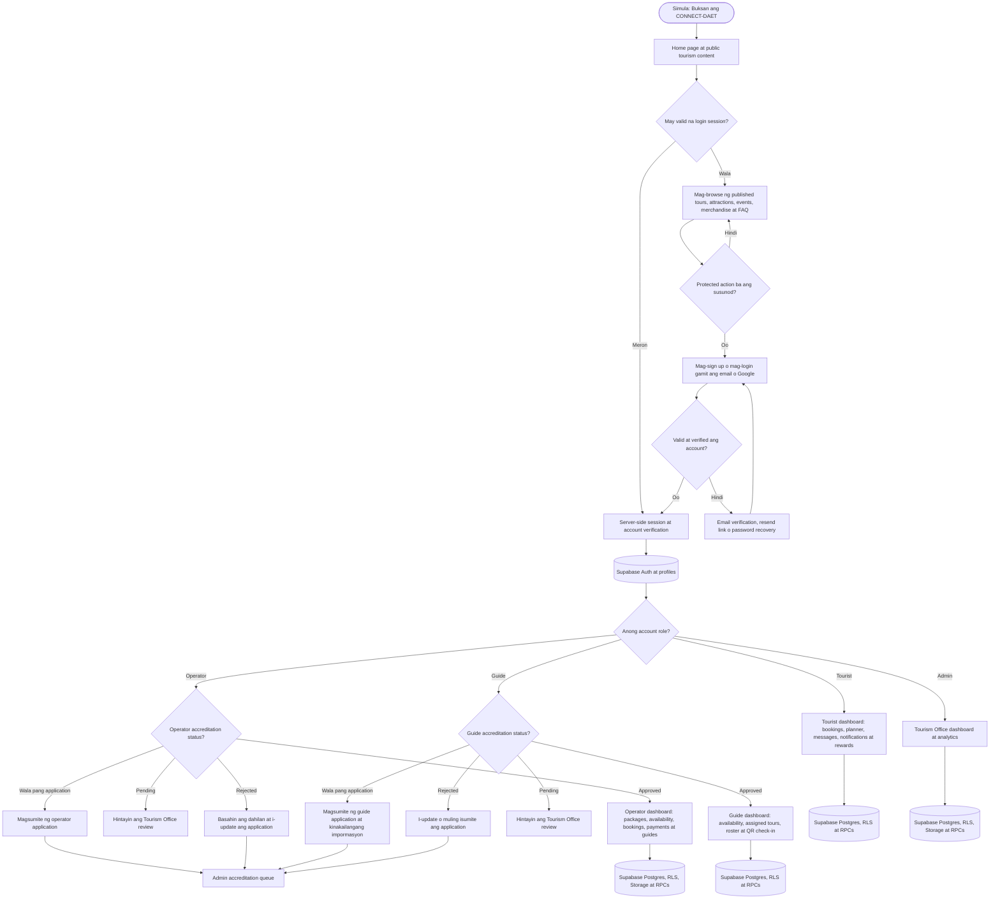
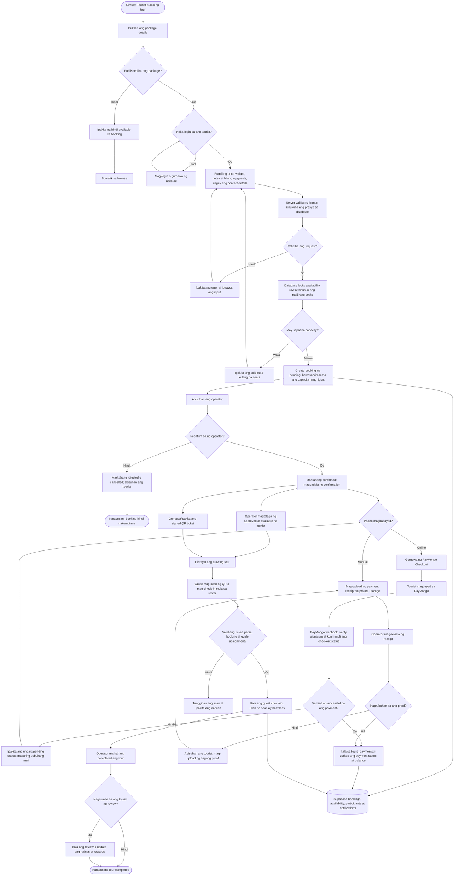
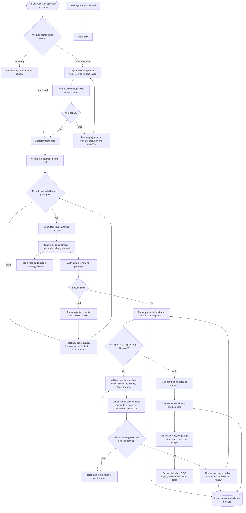
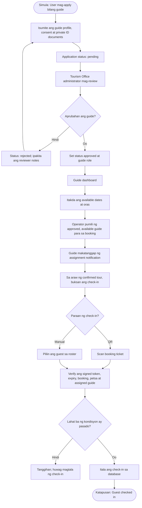
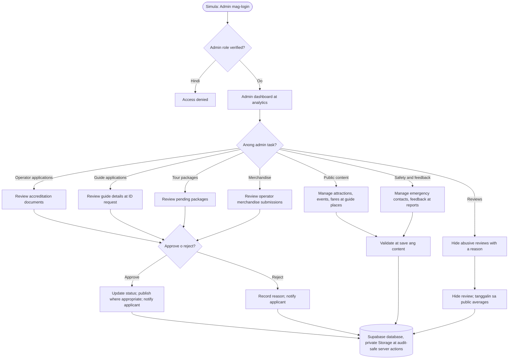
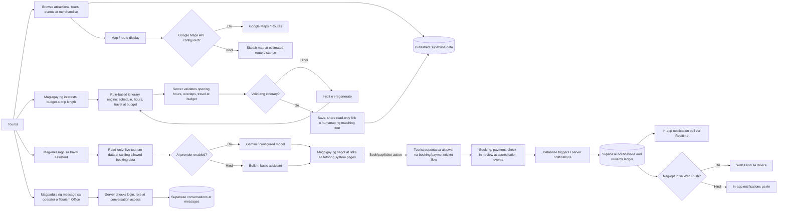
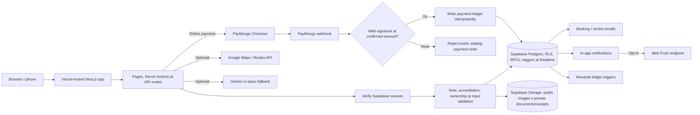

# CONNECT-DAET.ph — Buong System Flowchart

Ipinapakita ng mga diagram ang pangunahing proseso ng kasalukuyang CONNECT-DAET system: pag-login at role routing, tour booking, package management, guide check-in, Tourism Office administration, at mga supporting feature. Naka-base ito sa routes, server actions, README at migrations ng repository.

**Recommended browser version:** [CONNECT_DAET_WHOLE_SYSTEM_FLOWCHART.html](./CONNECT_DAET_WHOLE_SYSTEM_FLOWCHART.html). I-download at buksan sa browser; hindi kailangan ng Draw.io import o internet connection para makita ang diagrams. May print / Save as PDF button din ito.

**Editable Draw.io source:** [CONNECT_DAET_SYSTEM_FLOWCHART.drawio](./CONNECT_DAET_SYSTEM_FLOWCHART.drawio). Buksan sa [app.diagrams.net](https://app.diagrams.net) gamit ang **File → Open From → Device**.

## Legend

- **Oval** — simula o katapusan
- **Rectangle** — proseso o system action
- **Diamond** — decision / Oo-Hindi
- **Cylinder** — database o shared data service
- Mga solidong arrow — normal na daloy ng proseso

> Naka-format ang diagrams sa Mermaid. Nari-render ang mga ito sa GitHub kapag binuksan ang Markdown file.

## 1. Pangkalahatang system at role routing

## 2. Tourist tour-booking, payment at check-in flow

## 3. Operator application at package lifecycle

## 4. Guide accreditation, assignment at tour-day flow

## 5. Tourism Office admin flow

## 6. Planner, discovery, messaging at shared services

## 7. Shared technical flow at safeguards

## Buod ng mahahalagang decision points

1. **Account at role:** protected actions require a valid Supabase session. Bawat server action ay nagche-check ng role, accreditation at ownership; database RLS at RPCs ang pangalawang enforcement layer.
2. **Package publication:** bagong package ay draft → pending review → published o rejected. Ang published package ay puwedeng i-edit at maging live agad; ang `pending_review` at `archived` ay read-only.
3. **Booking:** published package lang ang nabobook. Server/database ang nagva-validate ng price, petsa at capacity para maiwasan ang overbooking.
4. **Payments:** PayMongo ay kinukumpirma sa signed webhook; manual receipts ay inaaprubahan ng operator. Pareho silang itinatala sa payment ledger.
5. **Check-in:** kailangan ang valid booking ticket o roster entry, tamang tour date at awtorisadong assigned guide/operator/admin. Isang guest lang ang naitatala nang isang beses.
6. **Other content:** events at attractions ay public information; merchandise showcase ay nagpapakita ng seller contact at hindi app checkout.
